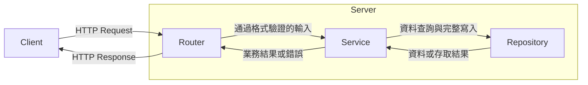
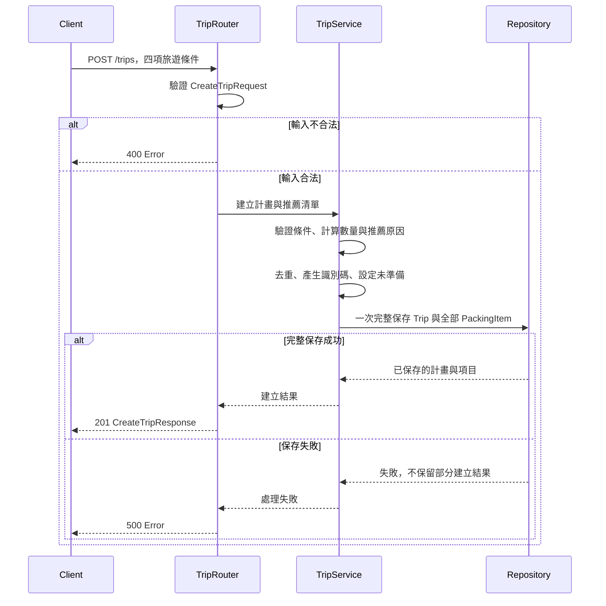
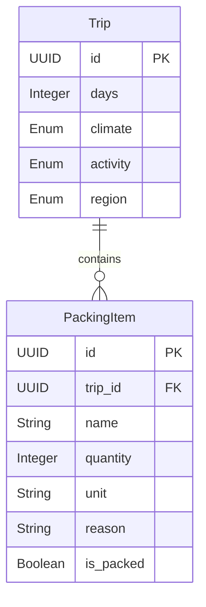

# 旅遊行李清單管理系統(Travel Packing List) — Architecture & Data Model

本文件依 [Requirements](01-requirements.md)、[API Design](02-api-design.md) 與 [OpenAPI](03-openapi.yaml)，說明系統分層、Request Flow、資料模型及需求追蹤。

**Design Only（尚未實作）**：維持六條 API、Trip 與 PackingItem 兩個 Entity。本文件僅描述邏輯設計，不指定程式框架、資料庫產品或部署方式，不產生程式碼、資料表或 Migration。

## 1. 系統架構



Client 提供旅遊條件與清單調整內容；Server 依序處理請求驗證、業務規則與資料存取，再回傳 JSON。推薦由固定規則完成，不呼叫外部服務。Repository 代表資料存取邊界，本階段不實作儲存設施。

下列元件名稱是邏輯職責名稱，不代表已建立對應的類別或程式檔。

## 2. Router／Service／Repository 職責

| 層級／邏輯元件 | 職責 |
| --- | --- |
| Router：TripRouter、PackingItemRouter、ProgressRouter | 接收對應 API；驗證 JSON、Path UUID、必填欄位、型別、Enum、數值範圍及允許欄位；PATCH 至少有一個可寫欄位。將輸入交給 Service，依結果回傳既定 HTTP 狀態碼與 Response Schema。 |
| Service：TripService | 驗證旅遊條件，依 BR-04、BR-05、BR-11 產生初始物品，依 BR-06 去重取最大數量，設定初始狀態，協調 Trip 與全部項目的完整建立。 |
| Service：PackingItemService | 先正規化並驗證名稱與單位，再確認計畫存在及項目所屬、檢查同名；處理新增、部分修改與刪除。依 BR-12～BR-14 保護不可寫欄位、保留原始原因，且不重新推薦。 |
| Service：ProgressService | 確認計畫存在，取得目前清單，依 BR-08 計算各項數量、完成率與未準備物品；完成率四捨五入至小數點後兩位。 |
| Repository | 提供 Trip 的建立與查詢，以及 PackingItem 的查詢、新增、部分欄位更新及刪除存取；不提供修改或刪除 Trip 的操作。支援以指定 tripId 篩選及同名檢查所需查詢，保障完整建立及單次 PATCH 變更的原子性。不決定推薦內容、數量公式或完成率。 |

Router 驗證可依 OpenAPI 判斷的輸入格式；Service 負責需讀取資料或結合業務情境的規則。像同名、項目所屬計畫、推薦結果及進度計算，不能僅靠 Request Schema 驗證。

驗證順序固定為：輸入格式及值（含 Service 正規化後的非空、長度）→ 計畫存在 → 項目存在及所屬 → 同名衝突 → 寫入。跳過操作不適用階段，首先失敗階段即回傳，不彙整全部錯誤；同階段內欄位錯誤不指定先後。即使計畫不存在，若名稱正規化後不合法，先回傳 400。

回應組裝時使用 API 欄位名稱，Entity 的識別碼映射見第 5 節。錯誤以既有 `Error` Schema 表示：

| 情境 | HTTP／code | 處理責任 |
| --- | --- | --- |
| JSON、UUID、必填欄位、型別、Enum、數量或欄位白名單不合法 | 400／INVALID_REQUEST | Router 驗證格式；Service 驗證去除空白後的內容等業務限制 |
| 手動操作與同計畫另一項目同名 | 400／DUPLICATE_ITEM_NAME | PackingItemService 根據 Repository 查詢結果判斷 |
| 計畫不存在 | 404／TRIP_NOT_FOUND | Service 確認 Repository 查詢結果 |
| 項目不存在或所屬計畫不符 | 404／ITEM_NOT_FOUND | PackingItemService 以 tripId、itemId 確認目標 |
| 非預期處理失敗 | 500／INTERNAL_ERROR | 沿呼叫鏈回傳失敗，由 Router 統一轉成錯誤回應，不揭露內部例外細節 |

項目所屬檢查是資料一致性檢查，不是使用者授權。系統不設登入或權限功能。

## 3. 核心 Request Flow：POST /trips

輸入範例沿用 OpenAPI 的五天國外寒冷登山：

```json
{"days":5,"climate":"COLD","activity":"HIKING","region":"INTERNATIONAL"}
```



1. TripRouter 驗證 `CreateTripRequest` 的 days、climate、activity、region，拒絕未知欄位及不合法輸入。
2. TripService 依 BR-01～BR-03、BR-10 確認條件，依 BR-04、BR-05、BR-11 推薦物品與原因。
3. 範例產生上衣 5 件、褲子 3 件、內衣褲 6 套、保暖外套 1 件、登山鞋 1 雙、登山背包 1 個、護照 1 本、簽證確認 1 項、旅行轉接插頭 1 個、充電器 1 個，共 10 項；不因國內規則加入身分證件與健保卡。
4. Service 依 BR-06 合併相同物品並取最大數量，配置 UUID 與所屬關係，所有項目 `is_packed = false`。簽證確認保留自行確認需求的提醒。
5. Repository 完整保存一筆 Trip 與全部初始項目。未來儲存實作必須提供原子性：全部成功或全部不保留，不可出現只有計畫或部分項目的成功結果。本文件不指定交易技術或資料庫。
6. 全部成功後才回傳 201，內容為 `{trip, items}`；格式驗證失敗回傳 400，非預期處理失敗回傳 500。

每次 POST `/trips` 都視為新建立，不提供重送去重保證。保存成功但回應未送達時仍保留計畫，逾時重送可能新增另一筆；原子性保證的是保存結果完整，不保證回應送達或重送只建立一次。

## 4. 清單調整與進度查詢流程

| 操作 | Router → Service → Repository 的處理 | 成功回應 |
| --- | --- | --- |
| GET `/trips/{tripId}/items` | PackingItemRouter 驗證 UUID；PackingItemService 確認計畫，透過 Repository 取得目前全部項目；不重新推薦。 | 200 ItemListResponse |
| POST `/trips/{tripId}/items` | 驗證 CreatePackingItemRequest；Service 先去除前後空白並驗證，再確認計畫、檢查同名，設定系統欄位後保存新項目。 | 201 PackingItem |
| PATCH `/trips/{tripId}/items/{itemId}` | 驗證 UpdatePackingItemRequest；Service 先正規化並驗證輸入，再確認計畫與項目所屬、檢查同名（排除自身），只寫入提供的欄位，單次請求變更全部成功或全部不生效。 | 200 PackingItem |
| DELETE `/trips/{tripId}/items/{itemId}` | 驗證 UUID；Service 確認計畫與項目所屬，由 Repository 刪除；不補回推薦、不提供復原。 | 204，無回應內容 |
| GET `/trips/{tripId}/progress` | ProgressRouter 驗證 UUID；ProgressService 確認計畫，從 Repository 取得同一份目前清單，再計算計數與未準備項目。 | 200 ProgressResponse |

新增由 Service 設定 `reason = 使用者自行新增`、`is_packed = false`，識別碼與所屬計畫不可由 Request Body 指定。修改保留原始 reason；只改名稱、數量或單位時保留準備狀態，若提供 is_packed 則依輸入更新。所有項目皆可修改或刪除，包括系統推薦文件。

驗證失敗不部分修改資料；項目不存在或所屬計畫不符回傳 404，不操作其他計畫的項目。同名檢查與保存須維持 BR-12 的同計畫名稱唯一性，具體儲存機制留待實作，不增加 API。

Repository 必須保證並行操作的結果也符合規則：同時新增同名物品只允許一筆成功，同時改名亦不可產生重複；名稱衝突由 Service 轉為 `400 / DUPLICATE_ITEM_NAME`，不得因保存時才發現衝突就改回 500。手動新增重送同樣依目前名稱檢查，不提供回傳原項目的保證。

並行 PATCH 僅寫入各請求提供的欄位，不以舊整筆資料覆寫未提供欄位。不同欄位的修改都保留，同欄位由後完成寫入的值覆蓋；同一請求多欄位變更全部成功或全部不生效，名稱唯一性仍須成立。具體交易、鎖定或儲存技術留待實作，不新增版本欄位或衝突 API。

## 5. Data Model

### 5.1 Trip

代表一筆旅遊計畫。以下欄位皆必須有值，不接受 null。

| Attribute | Type | 識別／限制 | API 對應與說明 |
| --- | --- | --- | --- |
| id | UUID | PK，系統產生 | Trip.tripId；計畫識別碼 |
| days | Integer | 1～30 | days；旅遊天數 |
| climate | Enum(WARM, COLD, RAINY) | 單選 | climate；氣候類型 |
| activity | Enum(SIGHTSEEING, BEACH, HIKING) | 單選 | activity；活動類型 |
| region | Enum(DOMESTIC, INTERNATIONAL) | 必填、單選 | region；旅遊地區類型 |

Trip 條件在建立時決定，本階段不提供修改或依新條件重新產生清單（BR-09）。

### 5.2 PackingItem

代表旅遊計畫中的一筆行李項目。以下欄位皆必須有值，不接受 null，沿用既有七個欄位。

| Attribute | Type | 識別／限制 | API 對應與說明 |
| --- | --- | --- | --- |
| id | UUID | PK，系統產生 | itemId；項目識別碼 |
| trip_id | UUID | FK → Trip.id | tripId；所屬計畫，不可由使用者改動 |
| name | String | 正規化後 1～100 個 Unicode 碼點，同計畫不可同名 | name；目前物品名稱 |
| quantity | Integer | 1～999 的整數 | quantity；初始為建議或手動新增數量，後續可覆寫 |
| unit | String | 正規化後 1～20 個 Unicode 碼點 | unit；例如件、套、張、本、項、個、份 |
| reason | String | 非空，系統設定、修改時保留 | reason；原始推薦依據或「使用者自行新增」 |
| is_packed | Boolean | 新項目初始 false，後續可改為 true 或 false | is_packed；目前準備狀態 |

reason 表示項目最初的推薦或新增依據；即使使用者改名或修改數量，仍保留原始原因，不重新計算推薦。不另存原建議數量、來源欄位或歷史版本。

名稱唯一性範圍是同一個 trip_id，依去除前後空白後完全相同比對，不做大小寫或同義詞轉換。不同計畫可以有同名項目。初始推薦依 BR-06 合併取最大數量；手動同名操作依 BR-12 拒絕，不自動合併。

正規化只去除兩端連續的一般空格（U+0020）、全形空白（U+3000）、Tab（U+0009）、CR（U+000D）、LF（U+000A），內部字元保持原樣，儲存去除後的值。先正規化再驗證非空及長度，並使用相同結果做同名判定。Request Schema 不直接限制原始輸入的 maxLength，正規化後的長度由 Service 驗證；Response 名稱／單位 Schema 限制保存結果為 100／20 字元以內。

### 5.3 Relationship 與識別碼映射



一筆 Trip 對應零到多筆 PackingItem；每筆 PackingItem 必須屬於一筆存在的 Trip。建立成功時有完整推薦清單，但使用者可以刪除全部項目，因此關聯的下限為零。這不代表允許建立計畫時遺漏推薦清單。

| Entity 欄位 | OpenAPI Schema／API 欄位 |
| --- | --- |
| Trip.id | Trip.tripId；Path Parameter tripId |
| PackingItem.id | PackingItem.itemId；Path Parameter itemId |
| PackingItem.trip_id | PackingItem.tripId，對應 Path 指定的計畫 |

這些是不同表示之間的映射，不是額外 Entity 欄位；其餘欄位名稱相同。PK／FK 為設計標示，不代表已建立資料表或索引。

## 6. Progress 為衍生回應

`ProgressResponse` 由目前清單計算，不建立 Progress Entity 或獨立資料表，也不在 Trip 增加計數或完成率欄位。

| 回應欄位 | 來源／計算方式 |
| --- | --- |
| tripId | Trip.id |
| total_count | 目前屬於該 Trip 的 PackingItem 數量 |
| packed_count | is_packed = true 的項目數 |
| unpacked_count | is_packed = false 的項目數 |
| completion_rate | packed_count / total_count × 100，四捨五入至小數點後兩位；total_count = 0 時為 0 |
| unpacked_items | 目前 is_packed = false 的完整項目表示，欄位依 PackingItem Schema |

必須滿足 `total_count = packed_count + unpacked_count` 與 `unpacked_count = unpacked_items.length`。完成率不依 quantity 加權，也不要求補零，例如 3 / 9 回傳 33.33、2 / 3 回傳 66.67、7 / 10 回傳 70。

新增、刪除或準備狀態更新後，再次查詢依目前清單計算。僅改名稱、數量、單位不改變項目數或完成率；未準備清單仍須反映最新內容。計畫存在但清單為空時，回傳 200，三項計數與完成率皆為 0，unpacked_items 為空陣列。

## 7. Traceability：FR → API → Schema → Component → Entity

下表 Schema 名稱均對應 [03-openapi.yaml](03-openapi.yaml) 的 `components/schemas`；Component 指本文件的邏輯元件。

| FR | API | OpenAPI Schema（Request → Response） | Component 呼叫鏈 | Entity／資料 |
| --- | --- | --- | --- | --- |
| FR-01、FR-02 | POST `/trips` | CreateTripRequest → CreateTripResponse（Trip、PackingItem） | TripRouter → TripService → Repository | 建立 Trip 與所屬 PackingItem；依四項條件推薦 |
| FR-03（查詢） | GET `/trips/{tripId}/items` | 無 Body → ItemListResponse（PackingItem） | PackingItemRouter → PackingItemService → Repository | 讀取 Trip 與目前 PackingItem |
| FR-03（狀態）、FR-06 | PATCH `/trips/{tripId}/items/{itemId}` | UpdatePackingItemRequest → PackingItem | PackingItemRouter → PackingItemService → Repository | 驗證所屬 Trip，更新指定 PackingItem |
| FR-04 | GET `/trips/{tripId}/progress` | 無 Body → ProgressResponse（PackingItem） | ProgressRouter → ProgressService → Repository | 讀取 Trip、PackingItem，計算衍生進度 |
| FR-05 | POST `/trips/{tripId}/items` | CreatePackingItemRequest → PackingItem | PackingItemRouter → PackingItemService → Repository | 驗證 Trip，新增一筆 PackingItem |
| FR-07 | DELETE `/trips/{tripId}/items/{itemId}` | 無 Body → 無內容（204） | PackingItemRouter → PackingItemService → Repository | 驗證 Trip 與項目所屬，刪除 PackingItem |

完整追蹤例子：FR-02 要求依旅遊地區推薦用品 → POST `/trips` 的 CreateTripRequest.region 引用 TravelRegion → TripRouter 驗證 DOMESTIC／INTERNATIONAL → TripService 套用 BR-11、BR-06、BR-07 → Repository 完整保存 Trip.region 與對應 PackingItem → 以 CreateTripResponse 回傳 Trip 與項目的名稱、數量、單位、原因及準備狀態。

所有帶 tripId／itemId 的 Path 使用 OpenAPI 共用 Parameters `TripId`／`ItemId`，Schema 引用 `Uuid`。錯誤統一使用 `Error`，不增加錯誤 Entity。

## 8. 設計邊界與一致性

- FR-01～FR-07 全部由既有六條 API 支援；不新增 Endpoint、Entity 或欄位。
- 推薦、個人調整與進度計算分屬 Service 職責，推薦規則不獨立建表。
- 保留既定 HTTP 201／200／204、400／404／500 與錯誤 code，完整契約見 API Design 與 OpenAPI。
- 不指定資料庫、ORM 或框架，不建立 User、RecommendationRule、Progress Entity，不增加登入、外部 API 或重新推薦功能。
- 本文件可作為後續實作的依據；本階段沒有可執行服務或系統測試。OpenAPI 的 Swagger Editor／完整規格驗證狀態依 API Design 的實際紀錄，不因架構文件完成而視為已驗證。
